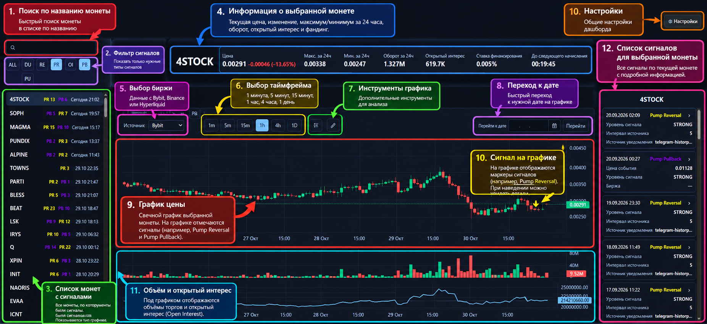
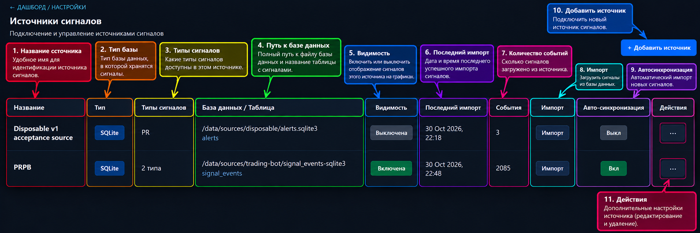
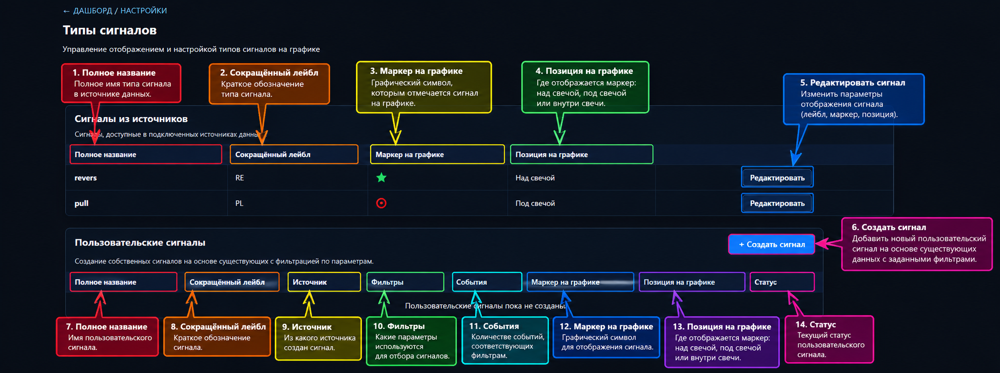
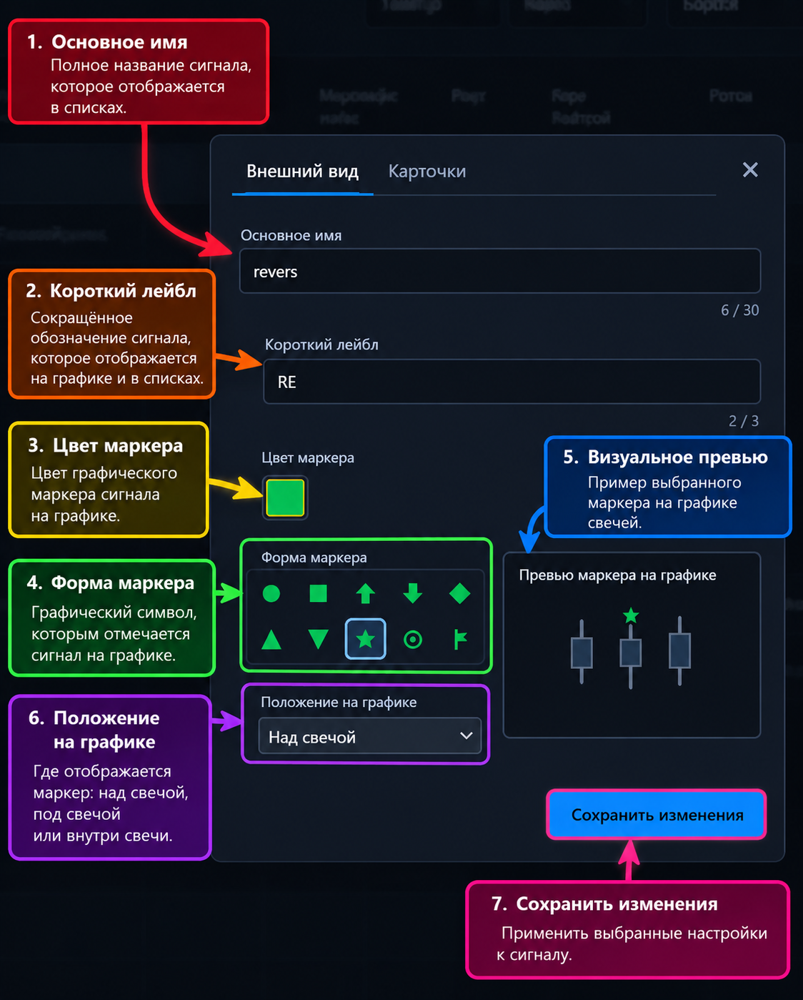
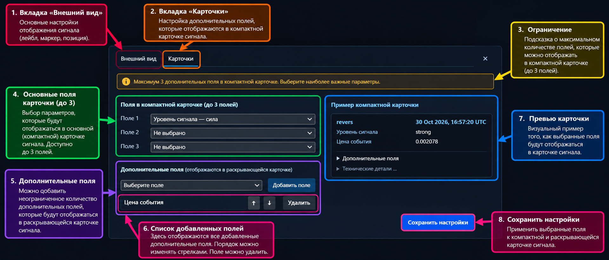

# Universal Trading Dashboard

Universal Trading Dashboard — веб-приложение для визуализации и анализа торговых сигналов на интерактивных графиках криптовалют.

Подключайте собственные базы сигналов, отслеживайте события на графиках Bybit, Binance и Hyperliquid, используйте фильтры и настраивайте отображение сигналов под свои задачи.

## Возможности

1. **Интерактивные графики** — просматривайте свечи Bybit, Binance и Hyperliquid с торговыми сигналами непосредственно на графике.

2. **Собственные источники сигналов** — подключайте SQLite-базы и импортируйте необходимые события.

3. **Гибкая фильтрация** — находите сигналы по монетам, типам событий и другим доступным фильтрам.

4. **Custom Signals** — создавайте пользовательские фильтры для уже импортированных событий, задавайте им названия и короткие обозначения и выбирайте, какие совпадающие события отображать на графике. Custom Signals не генерируют новые торговые сигналы.

5. **Персонализация маркеров** — настраивайте цвет, форму и положение маркеров для каждого типа сигнала.

6. **Карточки событий** — настраивайте отображение информации о сигналах.

7. **Автоматическая синхронизация (Auto Sync)** — новые сигналы из подключённых источников автоматически появляются в дашборде без необходимости вручную запускать импорт.

8. **История сигналов** — просматривайте ранее полученные сигналы, находите события за определённые даты и изучайте их расположение на историческом графике.

## Screenshots / Скриншоты

### Dashboard overview / Обзор Dashboard



### Signal Sources / Источники сигналов



### Signal Types / Типы сигналов



### Signal Appearance / Внешний вид сигнала



### Signal Card Layout / Макет карточки сигнала



## Требования

- Linux VPS с доступом по SSH;
- Python **3.12** или новее;
- `git`;
- доступ VPS в интернет для установки Python-зависимостей и публичных market
  data API. Браузеру также нужен доступ к `unpkg.com`, откуда загружается
  библиотека графиков.

Поддерживаемая серверная платформа первой версии — Linux VPS. К интерфейсу
Dashboard можно подключаться из браузера на Windows или macOS через SSH tunnel.
Первая версия оптимизирована для настольных компьютеров и ноутбуков; интерфейс
пока не оптимизирован для смартфонов.

## Быстрый старт на Linux VPS

Ниже используется каталог `$HOME/universal-trading-dashboard`. Выполняйте
команды под обычным пользователем, который будет запускать Dashboard.

```bash
sudo apt update
sudo apt install -y curl git python3.12 python3.12-venv

git clone https://github.com/Tarenoff/universal-trading-dashboard-release.git \
  "$HOME/universal-trading-dashboard"
cd "$HOME/universal-trading-dashboard"

python3.12 -m venv .venv
source .venv/bin/activate
python -m pip install --upgrade pip
python -m pip install .

mkdir -p data config
printf '%s\n' '{"signal_types": [], "sources": []}' > config/sources.json
```

Если ваш дистрибутив Linux поставляет Python 3.12 под другим именем, установите
его средствами дистрибутива и убедитесь, что `python3.12 --version` показывает
версию не ниже 3.12.

Дальше настройте две пользовательские службы systemd из подробной инструкции:
web Dashboard и его Auto Sync worker. Это единственный стандартный способ
запуска на Linux VPS. После создания unit запустите всю установку одной командой:

```bash
systemctl --user enable --now universal-trading-dashboard.service
```

При первом старте создаётся пустой EventStore в `data/events.sqlite3`; Dashboard
слушает `127.0.0.1:8000`. Проверьте службу и ответ на VPS:

```bash
systemctl --user status universal-trading-dashboard.service
curl -f http://127.0.0.1:8000/
```

Полная последовательная инструкция, включая оба systemd unit, lingering и SSH
tunnel, находится в
[docs/INSTALLATION_RU.md](docs/INSTALLATION_RU.md).

Главный unit автоматически запускает
`universal-trading-dashboard-sync.service`; оба используют один EventStore и
один `sources.json`. Новый source не импортируется сам: включите `Auto Sync`
для него в `Settings` → `Signal Sources`. Остановка или перезапуск главного
unit также останавливает или перезапускает worker. Доступ к браузеру по-прежнему
выполняется только через SSH tunnel к `127.0.0.1`.

## Открытие в браузере через SSH tunnel

Не меняйте `--host` на публичный адрес. На своём компьютере откройте отдельный
терминал и выполните:

```bash
ssh -L 8000:127.0.0.1:8000 USER@VPS_HOST
```

Замените `USER` и `VPS_HOST` своими значениями. Пока SSH-соединение открыто,
перейдите в браузере по адресу <http://127.0.0.1:8000>.

## Подключение SQLite-источника сигналов

После первого запуска откройте `Settings` → `Signal Sources` → `Add Source`.
Укажите **абсолютный** путь к своей SQLite-базе, выберите таблицу и сопоставьте
колонки в мастере. Проверьте preview, создайте source и выполните ручной
`Import` в таблице источников.

Внешняя SQLite-база открывается Dashboard только для чтения. При этом
`config/sources.json` и собственный EventStore Dashboard намеренно изменяются
при настройке источников и импорте. Храните их в каталоге, доступном только
пользователю Dashboard, и делайте резервные копии перед существенными
изменениями.

Пустой Dashboard не показывает символы и графики, пока не импортирован хотя
бы один сигнал. Это ожидаемое состояние.

## Безопасность

`universal-trading-dashboard` по умолчанию привязан к `127.0.0.1`. Встроенной
аутентификации для публичного доступа нет. Не публикуйте Dashboard напрямую в
интернет и не открывайте его порт в firewall; используйте SSH tunnel.

## Ограничения данных рынка

- Публичные API и история свечей зависят от доступности и ограничений каждой
  биржи; непрерывная или неограниченная история не гарантируется.
- Для Bybit, Binance и Hyperliquid требуется подключение к интернету.
- Hyperliquid в текущей реализации не поддерживает интервал `6h`.
- Источник сигналов и источник свечей независимы: маркеры размещаются по
  времени события на выбранном графике.

## Документация

- [Установка на Linux VPS](docs/INSTALLATION_RU.md)
